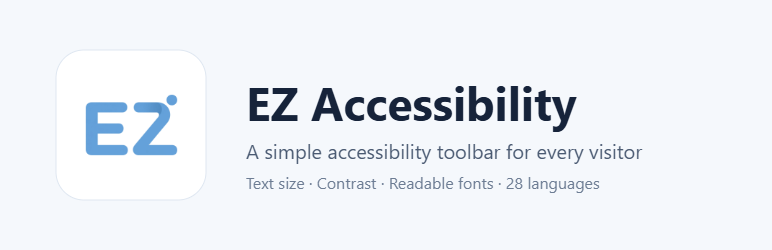
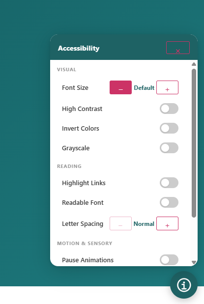

# EZ Accessibility

By [Greyteck Studios](https://greyteck.site) · [Plugin page](https://www.greyteck.site/products/ez-accessibility/)

A lightweight WordPress accessibility toolbar. Visitors get a floating button that opens a panel for text size, contrast, readable fonts, link highlighting, motion control and more. Their choices are remembered between visits.

No frontend dependencies, no external requests, and the panel lives in a Shadow DOM so theme styles can't break it.

> The WordPress.org listing is generated from [`readme.txt`](readme.txt). Keep the two in sync.

## Preview



## Features

**Visitor panel**
- Text size: scales the page's real font sizes, including Elementor inline styles
- High contrast, invert colors and grayscale (invert and grayscale can be combined)
- Highlight links, readable font, letter spacing
- Pause animations, large cursor
- One-click reset, with a badge on the button showing how many adjustments are active
- Keyboard accessible, with screen reader announcements, `prefers-reduced-motion` and forced-colors support

**Multilingual**
- 28 built-in languages (LTR and RTL), matched from `<html lang>` with regional fallback (`pt-BR` → `pt`)
- Add any other language from the admin, with its own direction and labels
- Override any built-in label; choose a fallback language
- RTL pages mirror the button and panel automatically
- Built-in labels live in [`assets/js/eza-i18n.js`](assets/js/eza-i18n.js), a static cached file; only overrides are inlined into pages

**Admin**
- Sectioned settings page with a live preview
- Brand color presets, custom colors and an automatic WCAG contrast check
- Five built-in button icons or an uploaded image (PNG/JPEG/WebP, 512 KB max; SVG refused). Uploads use the media library; on save the server re-checks the attachment's real file type and size
- Corner, size and edge-distance controls
- Per-feature toggles
- Show on the entire site or only on selected pages
- Language editor: pick any language, edit labels, add or delete your own
- Unsaved-changes bar, with Ctrl/Cmd + S to save

## Requirements

- WordPress 6.5+
- PHP 8.0+

## Installation from source

```bash
git clone https://github.com/shauryamohan20/Accessibility-Plugin.git ez-accessibility
cd ez-accessibility
git archive --format=zip --prefix=ez-accessibility/ -o ../ez-accessibility.zip HEAD
```

`.gitattributes` keeps `README.md`, `preview.png` and other dev-only files out of the zip. Use the same file list when copying into the WordPress.org SVN `trunk/`.

Upload the zip in **Plugins → Add New → Upload Plugin**, activate it, then open **EZ Accessibility** in the admin sidebar.

## WordPress.org listing artwork

The plugin icon and banners live in [`.wordpress-org/`](.wordpress-org) and are generated from the EZ logo:

| File | Used for |
| --- | --- |
| `icon-128x128.png`, `icon-256x256.png` | Plugin icon in the directory and in wp-admin search results |
| `banner-772x250.png`, `banner-1544x500.png` | Header banner on the plugin page (normal and high-DPI) |

They are not part of the plugin zip. Copy them into the top-level `assets/` folder of the WordPress.org SVN repository (next to `trunk/`), along with the `screenshot-N.png` files.

## JS API

```js
window.EZAccessibility.open()     // Open the panel
window.EZAccessibility.close()    // Close the panel
window.EZAccessibility.toggle()   // Toggle open/closed
window.EZAccessibility.reset()    // Reset every adjustment
window.EZAccessibility.refresh()  // Re-detect language after a language switch
```

## Upgrading from Qudra AccessKit

Settings saved by the old plugin are migrated automatically the first time EZ Accessibility loads.

## License

GPLv2 or later. See the [GNU General Public License](https://www.gnu.org/licenses/gpl-2.0.html).
