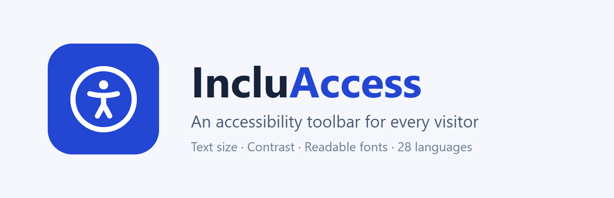
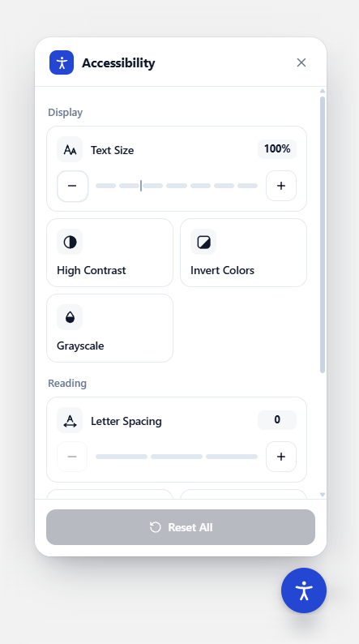

<p align="center">
  
</p>

<p align="center">
  A lightweight accessibility toolbar for WordPress.<br>
  By <a href="https://greyteck.site">Greyteck Studios</a> · <a href="https://www.greyteck.site/products/incluaccess/">Plugin page</a>
</p>

---



IncluAccess adds a small button to the corner of your site. Visitors open it to adjust the page to how they read best, and their choices are remembered on their next visit.

**What visitors can change**

- **Text size**, in steps, including text sized by page builders like Elementor
- **High contrast**, **invert colors** and **grayscale** (invert and grayscale can be combined)
- **Highlight links** and a **readable font**
- **Letter spacing**, in three levels
- **Pause animations** and a **large cursor**
- **Reset all** in one click; the button shows a small count of active changes

**Built for everyone**

- Fully keyboard accessible, with screen reader labels and announcements
- Respects "reduce motion" and Windows High Contrast settings
- 28 languages built in, left-to-right and right-to-left
- Fits any screen, from phones to wide monitors

<br clear="right">

## How it works

The panel is rendered inside a Shadow DOM, so your theme's CSS can't break it and the plugin's CSS can't leak into your theme. Page adjustments are applied as classes on `<html>`. Everything ships with the plugin: no external requests, no tracking, no frontend libraries.

## Settings

Open **IncluAccess** in the WordPress admin sidebar. Every change shows up in a live preview before you save.

| Section | What you can do |
| --- | --- |
| **Appearance** | Pick a brand color (with an automatic contrast check), one of five button icons or your own image, the button size, the corner and the distance from the edge |
| **Features** | Turn each visitor tool on or off |
| **Visibility** | Show the button on the whole site, or only on pages and posts you pick |
| **Languages** | Edit any built-in label, add your own languages (LTR or RTL), and choose a fallback language |
| **Advanced** | Change the stacking order (z-index) if a sticky header or chat widget covers the button |

### Languages

The panel picks its language from the page's `lang` attribute and uses the closest match: `pt-BR` uses Portuguese, `zh-TW` uses Traditional Chinese. Built in: English, Spanish, French, German, Italian, Portuguese, Dutch, Polish, Swedish, Romanian, Czech, Turkish, Greek, Russian, Ukrainian, Hindi, Bengali, Thai, Vietnamese, Indonesian, Simplified and Traditional Chinese, Japanese and Korean, plus four right-to-left languages.

Using a language that isn't listed? Add it under **Languages → Add language** with its code (for example `sw`), a name and its direction, then type your labels. Right-to-left pages mirror the button and panel automatically.

Built-in labels live in [`assets/js/inclu-i18n.js`](assets/js/inclu-i18n.js), a static file browsers cache. Only the labels you change are added to each page.

### Custom button icon

Choose **Your image** under **Appearance → Button icon** to upload or pick an image from the media library. PNG, JPEG and WebP are accepted, up to 512 KB. SVG is refused, because SVG files can contain code that runs in visitors' browsers.

## Privacy and security

- **No data leaves the site.** Visitor preferences are stored only in their own browser (`localStorage`).
- **Settings are admin-only.** Saving requires the `manage_options` capability and a valid nonce.
- **All settings are validated in one place,** whether they come from the form, the database or an older version.
- **Uploaded icons are checked on the server.** The form only sends an attachment ID. On save, the plugin reads the file itself to confirm it is a real PNG, JPEG or WebP under the size limit.

## Requirements

- WordPress 6.5 or later
- PHP 8.0 or later

## Installation

**From WordPress.org:** go to **Plugins → Add New**, search for "IncluAccess", install and activate.

**From source:**

```bash
git clone https://github.com/shauryamohan20/Accessibility-Plugin.git incluaccess
cd incluaccess
git archive --format=zip --prefix=incluaccess/ -o ../incluaccess.zip HEAD
```

Then upload the zip under **Plugins → Add New → Upload Plugin**. `.gitattributes` keeps development-only files (this README, `.wordpress-org/` and so on) out of the zip.

## JavaScript API

```js
window.IncluAccess.open()     // Open the panel
window.IncluAccess.close()    // Close the panel
window.IncluAccess.toggle()   // Toggle open/closed
window.IncluAccess.reset()    // Reset every adjustment
window.IncluAccess.refresh()  // Re-detect the language after a multilingual plugin switches it
```

## Project layout

```
incluaccess.php                         Plugin header, bootstrap, migration
uninstall.php                           Removes settings (all sites on multisite)
includes/class-incluaccess-settings.php Admin page, saving and validation
includes/class-incluaccess-frontend.php Loads the widget where it should appear
assets/js/inclu-frontend.js             Visitor widget (Shadow DOM)
assets/js/inclu-i18n.js                 Built-in translations
assets/js/inclu-admin.js                Settings page
assets/css/                             Widget, page-feature and admin styles
.wordpress-org/                         Icon, banners and screenshots for the plugin directory
```

## Publishing to WordPress.org

The WordPress.org listing is generated from [`readme.txt`](readme.txt), so keep it in sync with this file. The artwork in [`.wordpress-org/`](.wordpress-org) is not part of the plugin zip. Copy it into the top-level `assets/` folder of the SVN repository, next to `trunk/`:

| File | Used for |
| --- | --- |
| `icon-128x128.png`, `icon-256x256.png` | Plugin icon in the directory and in wp-admin search results |
| `banner-772x250.png`, `banner-1544x500.png` | Header banner on the plugin page (normal and high-DPI) |
| `screenshot-1.png`, `screenshot-2.png` | Screenshots on the plugin page (visitor panel, settings page) |

## Upgrading from earlier versions

IncluAccess was previously developed as "EZ Accessibility" and, before that, "Qudra AccessKit". Settings saved by either are carried over automatically the first time IncluAccess loads.

## License

GPLv2 or later. See the [GNU General Public License](https://www.gnu.org/licenses/gpl-2.0.html).
